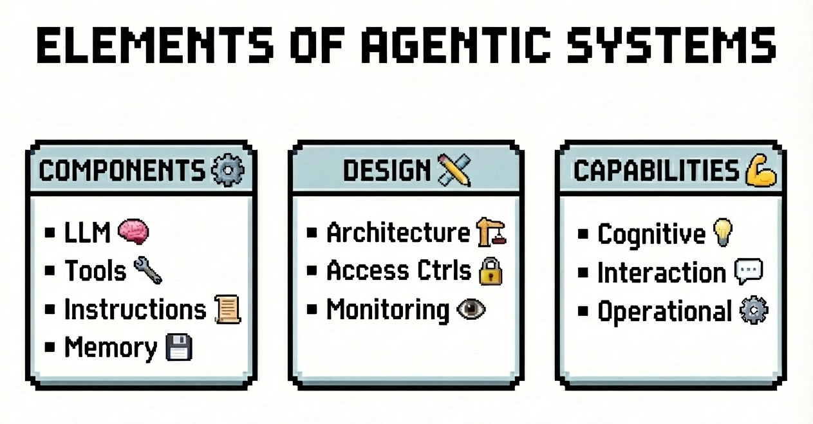

# Elements of agentic systems

!!! abstract "Page Summary"

    This page defines the three analytical elements used to assess agentic systems: components (LLM, instructions, tools, memory, protocols), design (architecture, access controls, monitoring), and capabilities (cognitive, interaction, operational). It provides a detailed taxonomy serving as a reference for identifying elements during risk assessment.

Across all agentic systems, there are three indispensable elements to examine:
**(1)** the components of an agent,
**(2)** the design of the agentic system, and
**(3)** the capabilities of the agentic system.

<figure style="text-align: center;">
  
</figure>

---

## Components

Components are essential parts of a single, standalone agent.
Here, we synthesise prevailing agreement on the key components of an agent from various sources, such as [**OpenAI**](https://cdn.openai.com/business-guides-and-resources/a-practical-guide-to-building-agents.pdf), [**LangChain**](https://python.langchain.com/docs/modules/agents/), [**Anthropic**](https://docs.anthropic.com/en/docs/build-with-claude/tool-use), and [**AWS**](https://docs.aws.amazon.com/bedrock/latest/userguide/agents.html).

* **🧠 LLM**: A large language model (LLM) is a neural network trained on massive text data to learn statistical patterns of language, enabling it to understand, generate, and reason over natural language inputs. It is the core reasoning engine that processes instructions, interprets user inputs, and generates contextually appropriate responses by leveraging its trained language understanding and generation capabilities. There are a large variety of LLMs to choose from, with different sizes, capabilities, and architectures, from large closed-source model families such as OpenAI's GPT, Anthropic's Claude, and Google's Gemini, to open-weights families such as Llama, Qwen, and Mistral, which include small models that can run on local hardware.

* **📋 Instructions**: Instructions are structured inputs provided to an LLM that define the task, constraints, and context, guiding how the model interprets inputs and generates outputs. They guide the LLM's decision process by conditioning prompts and tool use with objectives, policies, and guardrails. Forms include system prompts, policies, schemas, and rubrics, varying by framework and enforcement strictness.

* **🔧 Tools**: Tools are external functions, APIs, or resources attached to an LLM that extend its capabilities beyond text generation, enabling it to retrieve information, execute actions, and affect external systems (e.g., search, code execution, database queries, or file manipulation), typically through structured interfaces such as the [Model Context Protocol (MCP)](https://modelcontextprotocol.io/) that constrain invocation, inputs, permissions, and outputs for agentic control and safety.

* **💾 Memory**: Memory is a persistent or semi-persistent data store attached to an LLM that retains information across interactions—such as conversation history, user preferences, task state, and retrieved knowledge—enabling continuity, long-horizon reasoning, and personalization in agentic workflows. Memory may be implemented through mechanisms such as context windows, vector databases, episodic logs, or external state stores, each offering different trade-offs in latency, fidelity, and persistence. Every agent has working memory, the context it carries within a task; a system has persistent memory when it keeps information beyond a single session or shares it across users or tasks.

* **🔗 Protocols**: Protocols are the standard interfaces through which an agentic system connects to tools, services, and agents that another party builds or operates, such as the Model Context Protocol (MCP) for tool servers and agent-to-agent protocols such as A2A. A protocol governs how the other party is discovered, how it is identified and authenticated, what it declares about itself to the agent (tool descriptions, capability lists, agent cards), and how requests and results pass between the two. A system has this component when it makes at least one such connection, in either direction: its agents reach another party's tool server or agent, or another party's agents reach it. A function or API wrapper that the system's own team writes is a tool, not a protocol connection, because the team controls the description the agent sees.

!!! note "Conditional components"

    Every agentic system has an LLM, instructions, and tools. Memory and Protocols are conditional: a system has them only when a stated condition holds, and their risks apply only to systems that have them.

    - **Memory** is present when: the system keeps information beyond a single session, or shares it across users or tasks.
    - **Protocols** is present when: at least one tool server or agent that another party builds or operates is connected to the system through an agent protocol such as MCP or A2A, in either direction.

---

## Design

We now broaden our perspective to examine how agentic AI systems are assembled from individual agents from a system design perspective.

* **🏗️ Agentic Architecture**: The agentic architecture defines how an agentic system's control flow is structured: the loop through which a single agent plans, acts, and observes, and, where there are several agents, how they are structured, interconnected, and coordinated to collectively perform tasks that exceed the capabilities of a single agent. This includes orchestration patterns such as hierarchical delegation, parallel agent execution, sequential handoffs between specialised agents, shared or centralized planning components, and the communication protocols that govern information exchange and coordination across the system. Risks specific to multiple agents apply only to systems with the Agent Delegation capability. Different architectures result in varying levels of system-wide risk, and these need to be considered carefully. Similarly, the communication protocols by which agents exchange information — such as the [Agent2Agent (A2A) Protocol](https://a2a-protocol.org/latest/) or IBM's [Agent Communication Protocol (ACP)](https://research.ibm.com/projects/agent-communication-protocol) — may also give rise to security risks.

* **🔐 Roles and Access Controls**: Roles and access controls define and enforce differentiated roles, permissions, and scopes of authority across agents and system components, specifying what actions each agent is allowed to perform and which resources it may access. This includes assigning functional roles to agents, configuring tool- and data-level permissions, scoping credentials or identities, and enforcing access policies that govern interactions with files, systems, services, or other agents.

* **📊 Monitoring and Traceability**: Monitoring and traceability provide systematic visibility into agent behaviour, interactions, and decision pathways by recording, observing, and correlating agent actions and system events over time. This includes logging agent inputs and outputs, tracking tool invocations and state changes, capturing decision traces or execution paths, and surfacing telemetry or audit records that support analysis and review of system behaviour.

---

## Capabilities

We see three broad categories of capabilities — **cognitive**, **interaction**, and **operational** — which can be further broken down into more granular abilities.

### 🧩 Cognitive Capabilities

*Cognitive capabilities* encompass the agentic AI system's internal "thinking" skills — how it analyses information, forms plans, learns from experience, and monitors its own performance.

* **🎯 Planning & Goal Management**: The capability to develop detailed, step-by-step, and executable plans with specific tasks in response to broad instructions. This includes prioritizing activities based on importance and dependencies between tasks, monitoring how well its plan is working, and adjusting when circumstances change or obstacles arise.

* **👥 Agent Delegation**: The capability to assign subtasks to other agents and coordinate their activities to achieve broader goals. This includes identifying which components are best suited for specific tasks, issuing clear instructions, managing inter-agent dependencies, and monitoring performance or failures. A system has this capability whenever more than one agent works on a task, whether an agent decides the hand-offs or they are fixed in the workflow, and whether the other agents belong to the same system or are operated by another party, including agents it transacts with as counterparties.

* **🛠️ Tool Use**: The capability to evaluate available options and choose the best tool for specific subtasks, based on the capabilities and limitations of different tools and matching them appropriately to the tasks. This includes selecting between search, computation, code execution, or domain-specific APIs, determining when tool invocation is necessary, and sequencing or combining multiple tools to complete complex tasks effectively.

### 🔗 Interaction Capabilities

*Interaction capabilities* describe how the agentic AI system exchanges information with users, other agents, and external systems. These are differentiated based on how and what they interact with.

* **💬 Multimodal Understanding & Generation**: The capability to communicate with human users across multiple modalities, including natural language conversation (explaining topics, generating documents, interactive discussions) and multimodal understanding/generation (processing and creating image, audio, or video content such as visual analysis, speech transcription, or multimedia creation).

* **📧 Official Communication**: The capability to compose, finalise, and dispatch authoritative communications that formally and legally represent an organization to external parties (e.g. customers, partners, regulators, courts, or media) via approved channels and formats, thereby creating potential legal, regulatory, or reputational obligations. This includes sending legally binding correspondence, publishing official statements or press releases, and responding to external inquiries using the organisation's identity. A system has this capability whether a person sends what the agent drafts, approves each message before it goes, or lets the agent send by itself; that difference is recorded as the capability's authority.

* **💳 Business Transactions**: The capability to initiate, authorise, and execute binding business transactions with external parties - such as payments, purchases, reservations, or service commitments - resulting in real financial, contractual, or operational obligations for the organization. This includes processing payments or refunds, placing orders or subscriptions, booking services or reservations, and accepting or triggering contractual commitments on behalf of the organization. A system has this capability whether a person completes the transactions the agent prepares, approves each one, or lets the agent transact by itself within limits set in advance; that difference is recorded as the capability's authority.

* **🌐 Internet & Search Access**: The capability to autonomously access, browse, search, and retrieve information from the Internet to augment the LLM's static training knowledge with external and up-to-date sources in support of task execution and response generation. This includes issuing search queries, following and parsing web pages, extracting relevant facts or documents, and aggregating information from multiple online sources.

* **🖱️ Computer Use**: The capability to directly operate a computer's graphical user interface on behalf of the user, enabling the agent to navigate applications and execute tasks through mouse, keyboard, and window-based interactions. This includes moving the cursor, clicking buttons, entering text, using keyboard shortcuts, switching between windows and applications, and navigating files and menus within the operating system environment.

* **🔌 Other Programmatic Interfaces**: The capability to interact with external systems through non-graphical, programmatic interfaces, such as APIs, SDKs, and backend services, to exchange data or trigger actions as part of task execution. This includes calling REST or GraphQL APIs, invoking cloud services, publishing or consuming messages from queues or event streams, and performing operations such as code pushes, data updates, or system integrations across enterprise platforms. This includes sending and receiving email, chat, or other messages through an API or mail protocol, including when those messages are also Official Communication.

### ⚙️ Operational Capabilities

*Operational capabilities* focus on the agentic AI system's ability to execute actions safely and efficiently within its operating environment.

* **💻 Code Execution**: The capability to write, execute, and debug code in various programming languages to automate tasks or solve computational problems. This includes implementing algorithms, writing scripts, compiling and running code, debugging errors, and integrating with external systems through APIs or backend services.

* **📁 File & Data Management**: The capability to manage the full lifecycle of files and data by creating, reading, modifying, organizing, converting, querying, and updating information across both unstructured artifacts (e.g. documents, spreadsheets, media files) and structured data stores (e.g. SQL/NoSQL databases, data warehouses, vector or embedding stores) in support of operational tasks. This includes ingesting and transforming datasets, generating or updating files, maintaining directory or schema structures, executing database queries or updates, and storing or retrieving embeddings or derived data products.

* **⚡ System Management**: The capability to directly manage and configure technical systems and infrastructure by adjusting system settings, controlling computing resources, and administering operational environments across on-premise or cloud platforms. This includes monitoring system health and performance, managing authentication credentials and access controls, provisioning or scaling compute and storage resources, configuring operating system or runtime parameters, and applying system-level optimisations to support reliable operation.

### 🎚️ Context: how a capability is used

Two systems can have the same capability and very different exposure. An assistant that drafts a payment for a person to make and an agent that pays suppliers by itself both have Business Transactions. For each capability that acts on the world, ARC therefore records three things about how the system uses it.

**Authority** is how far the agent goes without a person:

| Authority | Meaning |
| --- | --- |
| **Read** | The agent only observes or retrieves through this capability |
| **Propose** | The agent prepares the action and a person carries it out |
| **Act with approval** | The agent carries out the action after a person approves that action |
| **Act alone** | The agent carries out the action without a person approving each one, whether freely or within limits set in advance |

**Irreversible** records whether the capability can make changes that cannot be readily undone. **External** records whether its effects reach people or systems outside the organisation.

| Capability | Authority levels | Irreversible effects | Effects outside the organisation |
| --- | --- | --- | --- |
| Official Communication | propose, act with approval, act alone | always | always |
| Business Transactions | propose, act with approval, act alone | ask | always |
| Internet & Search Access | read | never | always |
| Computer Use | act with approval, act alone | ask | ask |
| Other Programmatic Interfaces | read, propose, act with approval, act alone | ask | ask |
| Code Execution | propose, act with approval, act alone | ask | ask |
| File & Data Management | read, propose, act with approval, act alone | ask | ask |
| System Management | read, propose, act with approval, act alone | ask | ask |

The cognitive capabilities and Multimodal Understanding & Generation carry no context, because they do not act on anything by themselves.

The context is used in three ways:

1. **Some risks need a minimum authority.** Unintended deletion of files (RISK-041) cannot arise in a system that only reads them. A risk of this kind states the authority it needs, and it applies only at that level or above.
2. **Some controls are stricter in context.** A control can state a context in which it moves to a higher level. For example, logging every tool invocation (CTRL-0043) is Level 1 in general and Level 0 when a capability acts alone.
3. **Capability combinations** read the context too, since a capability used only to read cannot send anything out.

Where the context is not stated, an assessment assumes the most cautious case: the highest authority the capability allows, with irreversible and external effects. Nothing drops out of an assessment until the context shows that it can.

These three factors correspond to those in [IMDA's Model AI Governance Framework for Agentic AI](https://www.imda.gov.sg/-/media/imda/files/about/emerging-tech-and-research/artificial-intelligence/mgf-for-agentic-ai.pdf): the scope of an agent's actions, their reversibility, the agent's level of autonomy, and its access to external systems.
